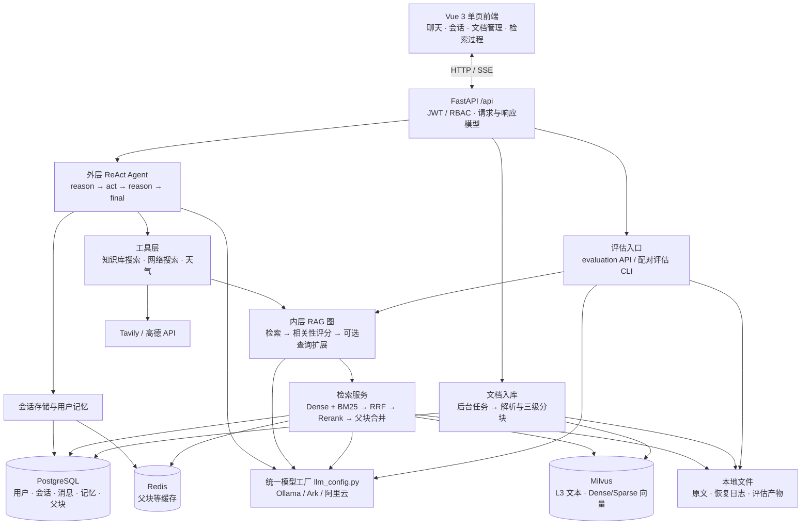
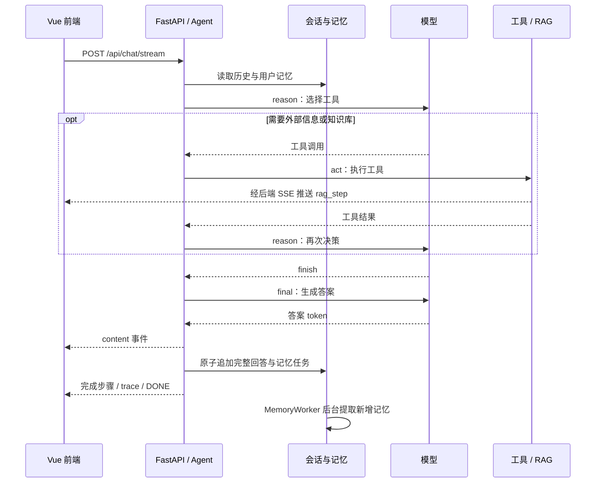
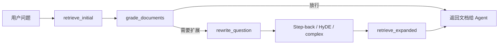

# StarMew / SuperMew 当前项目架构

核对日期：2026-09-28。以 `SuperMew/` 当前工作区源码（包括未提交修改）、依赖声明和部署配置为依据。本文描述代码与配置状态，不代表服务连通性或端到端运行验证。

局部更新：2026-10-01 已更新第 4 节的重排、父块合并与检索锁行为，以及第 3、6 节的增量记忆/token 预算行为；其他内容保留上述核对日期。

项目目录仍叫 **SuperMew**，当前页面标题和 Python 项目名使用 **StarMew / 星喵**。

## 1. 整体定位

这是一个以知识库问答为核心的 **模块化单体 Agent 应用**：Vue 单页前端与 FastAPI 后端同源部署，后端通过 LangGraph 编排工具调用和 RAG 检索，使用 PostgreSQL、Redis、Milvus 与本地文件协同保存状态。另外有独立的 RAG / 无 RAG 配对评估工具链。

图中两类评估入口职责不同：单条评估 API 接收现成答案；配对评估 CLI 自己组织检索、生成、评分和报告。

## 2. 代码分层与职责

| 层次 | 主要文件 | 职责 |
|---|---|---|
| 前端表现层 | [index.html](../frontend/index.html)、[script.js](../frontend/script.js)、[style.css](../frontend/style.css) | Vue 3 CDN 单页应用；聊天、历史会话、批量/文件夹上传、文档删除、来源与过程侧栏、主题和移动端适配 |
| 应用入口 | [app.py](../backend/app.py)、[run.py](../run.py) | 注册 `/api` 路由、CORS、根路径静态文件；首次 HTTP 请求触发数据库建表；提供启动入口 |
| HTTP 接口层 | [api.py](../backend/api.py)、[schemas.py](../backend/schemas.py) | 认证、会话、聊天、文档、记忆和评估接口；请求校验与响应结构 |
| 身份与权限 | [auth.py](../backend/auth.py) | JWT Bearer Token、PBKDF2 密码哈希、`admin/user` 角色校验 |
| 对话编排 | [agent.py](../backend/agent.py) | 外层 ReAct 图、历史消息加载、短期摘要、SSE、最终回答保存 |
| 工具能力 | [tools.py](../backend/tools.py) | 知识库搜索、Tavily 网络搜索、高德天气；请求级工具状态与进度推送 |
| RAG 编排 | [rag_pipeline.py](../backend/rag_pipeline.py) | 初次检索、相关性评分、Step-back / HyDE / complex 扩展与再次检索 |
| 检索实现 | [rag_utils.py](../backend/rag_utils.py) | 候选召回、重排、Dense 降级、L3→L2→L1 自动合并 |
| 文档处理 | [document_loader.py](../backend/document_loader.py)、[text_normalizer.py](../backend/text_normalizer.py) | 文档加载、中文文本归一化、递归字符三级分块 |
| 向量与索引 | [embedding.py](../backend/embedding.py)、[bm25.py](../backend/bm25.py)、[milvus_client.py](../backend/milvus_client.py)、[milvus_writer.py](../backend/milvus_writer.py) | 本地 Dense 嵌入、文本预处理、Milvus 原生 BM25 与混合检索、分批写入 |
| 业务存储 | [models.py](../backend/models.py)、[database.py](../backend/database.py)、[cache.py](../backend/cache.py)、[parent_chunk_store.py](../backend/parent_chunk_store.py) | ORM、连接与会话、Redis JSON 缓存、父分块存取 |
| 长期记忆 | [memory.py](../backend/memory.py) | 用户事实提取、话题识别、记忆上下文组装与记忆管理方法 |
| 后台文档任务 | [upload_jobs.py](../backend/upload_jobs.py) | 进程内任务状态、分阶段进度、异步入口的索引写入串行锁 |
| 模型与追踪 | [llm_config.py](../backend/llm_config.py)、[langsmith_config.py](../backend/langsmith_config.py) | 按角色解析模型配置；可选 LangSmith 追踪 |
| 质量评估 | [evaluation.py](../backend/evaluation.py)、[eval_comparison/](../backend/eval_comparison/)、[run_rag_comparison.py](../scripts/run_rag_comparison.py) | Ragas 指标、配对实验、断点恢复、结果统计和导出 |

`langchain-study/` 是学习实验代码。外层工作区的 `Template-Project/` 是独立项目，均不属于当前应用运行主链路。

## 3. 一次聊天如何完成

前端通过 `POST /api/chat/stream` 发送问题、`session_id` 和 `request_id`，使用 `fetch + ReadableStream` 消费 SSE。重试沿用同一请求 ID；旧客户端省略 ID 仍可用，但跨 HTTP 请求不保证去重。

1. **鉴权与上下文准备**：解析 JWT，按用户和会话加载消息；长期记忆只注入一次。历史按 token 预算滚动摘要，摘要及已处理进度持久化，下轮只合并新增旧消息；数据库仍保存完整对话。
2. **外层 Agent 决策**：异步 `reason` 节点只做工具选择，允许选择知识库、网络、天气或 `finish`。`finish` 是开始最终回答的控制信号。
3. **执行工具**：`act` 为每个工具调用返回同 ID 的 `ToolMessage`，包括失败、跳过和预算耗尽。默认最多 4 次决策、4 次工具、2 个不同知识库查询、4 次实际检索。相同签名最多对可重试错误重试一次。`internal_only` 同时限制网络搜索和天气的模型绑定与执行，来源策略跨摘要持久化，用户明确解除后恢复。
4. **生成最终回答**：收到 `finish` 后进入不绑定工具的 `final` 节点。后端只向客户端转发这个节点的答案文本。
5. **保存与结束**：`append_turn` 在一个事务中追加两条消息、保存上下文/trace、完成 `ChatTurn` 并新增 `MemoryUpdateJob`，提交后发送完成事件。长期记忆由持久后台任务执行，失败不会把已经成功的回答改为失败。

SSE 事件包括 `rag_step`、`content`、`trace`、`error` 和 `[DONE]`。进度通过 `ContextVar` 中的请求专属状态、`asyncio.Queue` 和 `call_soon_threadsafe` 从同步工具线程送到响应流；前端在同一消息气泡内从等待状态切换到答案显示。这里的过程展示是工具与检索进度。

前端用 `AbortController` 取消流，后端关闭图流并取消异步任务；未完成回答不走正常保存流程。同步工具已经开始的工作仍受其自身调用和超时控制。

还保留 `POST /api/chat` 同步接口，同样只保存最终完整回答。相同会话在一轮执行中返回明确的 HTTP 409 `SESSION_BUSY`；完成的同请求可重放，输入不同则拒绝。不同会话可并行；模型运行期间不持有数据库会话锁。同步请求断连后排空真实工作线程，完整提交可供重放；流式用户停止不保存半段回答。

## 4. 知识库检索如何工作

外层 `search_knowledge_base()` 调用内层 `run_rag_graph()`。**RAG 子图返回文档、上下文和 trace，最终自然语言答案由外层 Agent 生成。**

一次 `retrieve_documents()` 的具体步骤：

| 步骤 | 当前实现 |
|---|---|
| 查询编码 | 本地 BGE-m3 Dense 向量 + 原生 BM25 文本查询；保留数字、版本和标识符，中文使用连续 1/2/3 字符特征；查询不读写本地 BM25 状态 |
| 召回 | 默认过滤 `chunk_level == 3`；`top_k=5`，候选倍率默认 6，即融合后候选 30 条 |
| 融合 | Milvus 两路 `AnnSearchRequest`，`RRFRanker(k=60)`；每路还会取融合候选数的两倍 |
| 一致性快照 | 在索引锁内检查恢复状态、编码并召回，复制候选文档及可能使用的两级父块；随后释放锁 |
| 重排 | 在锁外调用外部 Rerank API，未配置时尝试 LLM 自评分；有效分数降序，同分保留原召回顺序；失败时保留候选顺序 |
| 补充上下文 | 仅使用已捕获的父块快照；默认同父命中阈值为 2，依次尝试 L3→L2、L2→L1；父块继承子块最高有效分数和最靠前的召回名次 |
| 异常降级 | 普通混合检索异常时尝试 Dense-only；格式不匹配则明确要求迁移，禁止混用旧稀疏索引 |

Dense 索引采用 HNSW/IP；Sparse 索引采用 `SPARSE_INVERTED_INDEX`，度量为 BM25，算法为 `TAAT_NAIVE`。Milvus 统一维护统计并评分，旧集合需要先按 [BM25 迁移说明](BM25.md) 重建到新集合。

查询扩展提供三种组合：`step_back` 生成更抽象的问题与辅助回答；`hyde` 生成假设性文档用于检索；`complex` 依次组合这两条路径并去重。扩展检索后直接返回，没有第二轮评分循环。

重排会校验编号、有限数值分数及 LLM 的 0–10 分范围，重复编号取最高有效分数。LLM 部分评分时，未评分候选按召回顺序排在有效评分之后；外部服务只采用其有效评分结果。只有非空有效评分被采用时，`rerank_applied` 才为真；空结果、无效结果及调用失败通过 `rerank_error` 记录降级。合并后的排序优先使用 `rerank_score` / `llm_rerank_score`，没有有效重排分数时才使用原始 `score`，避免不同量纲的分数互相覆盖。

索引锁保护候选与父块快照的一致性，慢速模型和 HTTP 重排调用在锁外完成，因此等待重排不会占用上传/删除使用的索引锁。正在处理的请求可以返回更新前捕获的完整文档版本，后续请求读取更新后的版本。恢复状态异常仍在降级处理之外抛出；锁仍是当前服务进程内的锁。

**仍需按实际代码理解的行为：**当前相关性评分若判为不相关，但已有检索结果，会强制放行；评分模型不存在时则直接走重写。这一放行策略不在本次重排修复范围内。

## 5. 文档如何入库和删除

主前端使用异步任务接口，批量上传由前端逐个提交并等待任务结果。

| 层级 | 默认块大小 / 重叠 | 保存位置 | 作用 |
|---|---|---|---|
| L1 根块 | 1200 / 240 字符 | PostgreSQL `parent_chunks` | 较大范围上下文 |
| L2 父块 | 600 / 120 字符 | PostgreSQL `parent_chunks` | 局部上下文 |
| L3 叶块 | 300 / 60 字符 | Milvus | 检索与向量化 |

以上是 `DocumentLoader()` 无参数初始化时的字符长度配置，不是 token 数，也不是每块必然达到的实际长度。分块使用递归字符分隔规则。扩展名白名单包括 PDF、Word、Excel、Markdown；其中 PDF 处理的是文本提取与归一化，当前主链路没有 OCR 或图像理解阶段。

索引写入前准备新叶块的 Dense 向量并保存恢复快照，默认每批 50 个块写入 Milvus；稀疏向量由原生 BM25 函数从 lexical_text 生成。API 与检索层共享稠密嵌入服务，BM25 不再依赖本地词表和统计文件。

覆盖与删除通过强一致游标保存旧块、Dense 向量、lexical_text 及父块，再修改 Milvus 和父块存储；BM25 随 Milvus 数据一起更新，失败依靠持久恢复日志补偿。文档身份主要以文件名区分，因此不同上传目录里的同名文件会映射为同一个知识库文档。删除接口保留磁盘上的原文件。

后台工作通过 FastAPI `BackgroundTasks` 执行；任务状态持久化在 SQLite，前端轮询任务进度。同步和异步上传、删除均经过统一的索引修改入口，使用进程内锁串行修改共享索引；后端进程锁限制同一任务库只有一个所有者。

## 6. 数据归属与持久化

| 载体 | 保存内容 | 当前边界 |
|---|---|---|
| PostgreSQL | `users`、`chat_sessions`、`chat_messages`、`user_memories`、`parent_chunks` | 用户、会话、消息和长期记忆的数据模型按用户关联；父块为共享知识库数据 |
| Redis | 父分块等缓存；记忆模块也有缓存写入方法 | 默认一般缓存 TTL 300 秒；会话消息/列表及记忆上下文读取直接查数据库，不信任旧会话缓存 |
| Milvus | L3 文本、来源信息、父子块 ID、Dense 与 Sparse 向量 | 共享集合，没有用户或租户过滤字段 |
| `data/documents/` | 上传原文及 `.staging/<job_id>/` 暂存文件 | 应用本地文件系统，不是直接上传到 MinIO |
| `data/bm25_state.json` | 词表、文档频率、文档数、总长度 | 必须与向量库语料配套理解；已有 Sparse 向量不会因统计变化自动全量重算 |
| 进程内存 | 上传/删除任务进度、普通评估器历史、模型与客户端对象 | 重启后任务状态和普通评估历史不保留 |
| `data/rag_comparison/<run_id>/` | 配对评估样本、配置、检查点、统计、报告 | 独立文件持久化，可校验指纹后续跑 |

账号与会话由 JWT 身份限制访问，文档管理要求管理员；普通登录用户可通过 Agent 使用共享知识库。当前产品的数据边界可概括为：**个人会话与记忆 + 公共知识库**。

短期摘要按 token 预算增量生成，保存在会话 `metadata_json.context_state`。后台 `MemoryWorker` 通过 `memory_checkpoint` 只提取未处理消息；事实、计数和进度原子提交，失败可重试。每个实际模型边界（包括评分、重写、摘要和记忆）都检查输入及结构化 schema 预算，输出上限取原配置与回答预留的较小值，配置及运维见 [MEMORY_SYSTEM.md](MEMORY_SYSTEM.md)。聊天主链路仍未自动调用每日摘要辅助方法 `add_session_summary()`。

## 7. 模型、评估与可观测性

`llm_config.py` 将模型按用途分为 `generation`、`judge`、`fast`、`evaluation`，统一通过兼容 OpenAI 协议的 LangChain 模型初始化入口创建。

本次读取的本地 `.env` 非敏感配置如下；实际进程环境可以覆盖文件配置：

| 用途 | 配置状态 |
|---|---|
| 聊天生成 | `LLM_PROVIDER=ollama`，`OLLAMA_MODEL=qwen3.5:4b` |
| RAG 相关性评分 | `OLLAMA_JUDGE_MODEL=qwen3.5:4b` |
| 轻量记忆提取 | `OLLAMA_FAST_MODEL=qwen3.5:4b` |
| 独立评估裁判 | `EVALUATION_PROVIDER=aliyun`，`GRADE_MODEL=qwen3.7-flash` |
| Dense 嵌入 | 本地 `D:/models/bge-m3`，CPU，配置维度 1024 |

`EVALUATION_PROVIDER` 只改变评估裁判的提供方，不改变聊天生成或 RAG 内部评分。代码还支持 `ark`、`aliyun` 作为应用模型提供方。密钥和接口地址由环境配置读取。

评估有两套入口：

- **普通评估 API**：`evaluation.py` 接收问题、答案、检索上下文和可选参考答案，计算 Ragas 指标，并提供历史、均分、可视化数据和导出接口。历史保存在共享评估器内存中，尚未按用户单独存储。
- **配对评估 CLI**：`scripts/run_rag_comparison.py` 配合 `backend/eval_comparison/`，支持 `validate / run / resume / report`。同题分别执行 `no_rag` 与 `rag`，使用受控生成器，再独立评分；有配置与语料指纹、原子检查点、运行锁、超时和尝试记录。主指标为 factual correctness F1，并统计拒答行为；支持 RAG 诊断指标、配对差值、按来源组 bootstrap 和人工复核表。

配对工具测量的是“检索链路 + 受控生成器”的收益，范围不包含线上 Agent 的工具选择、会话记忆和网络工具。操作方法见 [RAG_COMPARISON.md](RAG_COMPARISON.md)。

普通 `/api/evaluation/batch` 当前把 `run_rag_graph` 直接交给期望 `{answer, docs, rag_trace}` 的评估函数，但 RAG 子图并不返回 `answer`；因此这条接口不能直接当成完整问答生成测评。配对 CLI 有单独的答案生成步骤。

可观测性主要来自 SSE 检索步骤、回答关联的 `rag_trace`、任务进度及评估文件。LangSmith 为可选项；Ollama 模式明确关闭 tracing。当前前端没有独立的记忆或评估工作区，这些能力主要通过后端接口与脚本使用。

## 8. API 按业务划分

所有业务路由统一带 `/api` 前缀。

| 业务 | 主要路由（省略 `/api`） | 权限 |
|---|---|---|
| 账号 | `POST /auth/register`、`POST /auth/login`、`GET /auth/me` | 注册/登录公开；个人信息需登录 |
| 聊天 | `POST /chat`、`POST /chat/stream` | 登录用户 |
| 会话 | `GET /sessions`、`GET /sessions/{session_id}`、`DELETE /sessions/{session_id}` | 本人会话 |
| 文档列表 | `GET /documents` | 管理员 |
| 异步文档任务 | `POST /documents/upload/async`、`GET /documents/upload/jobs`、`GET /documents/upload/jobs/{job_id}`、`DELETE /documents/delete/async/{filename}`、`GET /documents/delete/jobs/{job_id}` | 管理员 |
| 同步文档接口 | `POST /documents/upload`、`DELETE /documents/{filename}` | 管理员 |
| 记忆 | `GET /memory`、`POST /memory/update`、`DELETE /memory/reset` | 本人记忆 |
| 单条与批量评估 | `POST /evaluation/run`、`POST /evaluation/batch` | 单条需登录；批量需管理员 |
| 评估管理 | `/evaluation/history`、`/evaluation/scores`、`/evaluation/visualization`、`/evaluation/export`、`/evaluation/dataset` | 登录用户；当前使用共享评估历史 |

## 9. 部署形态与当前架构边界

Python 要求为 **3.12+**，由 [pyproject.toml](../pyproject.toml) 声明。前端无需单独的 Node/Vite 构建，Vue、marked、highlight.js 从 CDN 加载；FastAPI 同时提供前端静态文件和业务 API。

| 服务 | 配置中的端口 | 部署位置与作用 |
|---|---|---|
| FastAPI / Uvicorn | 8000 | 本机 Python 进程；当前 Compose 不包含应用容器 |
| Ollama | 默认 11434 | 本地模型服务；当前 Compose 不包含该服务 |
| PostgreSQL 15 | 5432 | Compose；业务持久化 |
| Redis 7 | 6379 | Compose；缓存 |
| Milvus 2.5.14 standalone | 19530，健康检查 9091 | Compose；向量库 |
| etcd | 容器网络内 2379 | Milvus 元数据依赖；当前没有映射宿主机端口 |
| MinIO | 9000 / 9001 | Milvus 对象存储依赖 / 管理界面 |
| Attu | 宿主机 8080 → 容器 3000 | Milvus 管理界面 |

部署依据为 [docker-compose.yml](../docker-compose.yml)。常用启动顺序是在 `SuperMew/` 中执行 `docker compose up -d`，准备已配置的模型服务，再执行 `uv run uvicorn backend.app:app --host 0.0.0.0 --port 8000 --reload`。前端地址为 `/`，OpenAPI 文档为 `/docs`。

当前架构的几个边界会影响后续扩展：

1. **使用单后端进程部署**：索引锁和普通评估历史仍有进程内状态，启动锁限制同一任务库只有一个后端所有者；不能仅增加 Uvicorn workers 就认为多实例状态已经协调好。
2. **跨存储写入采用补偿恢复**：父块、Milvus 和原文按阶段更新，持久快照用于失败与重启后的回滚；未完成恢复会阻止继续读写索引。这不是分布式 ACID 事务。
3. **会话由应用自行维护**：LangGraph 没有启用 checkpointer；PostgreSQL 保存追加历史、请求状态和持久记忆任务。消息和会话列表每次查询数据库，避免旧读回填、Redis DELETE 故障恢复或进程重启读到旧历史；代价是增加数据库读取，尚无高并发吞吐结论。写后旧键清理仅为 best-effort 兼容，不能影响读取正确性。
4. **数据库按模型自动建表**：取得独占启动锁后 `Base.metadata.create_all()` 新建 `chat_turns`、`memory_update_jobs`，不重写已有 `chat_sessions`/`chat_messages`，不改变历史 ID、时间或 trace；这不是已有表字段变更的迁移系统。随后恢复中断请求和 running 记忆任务。
5. **工具集直接在代码中绑定**：当前运行工具为知识库、网络搜索和天气。仓库有 MCP 方案文档，但主代码尚未接入 MCP 客户端或多 Agent 调度。

早期文档中的“仅使用 Ark”“按 token 的较大三级分块”“只有 PDF/Word/Excel”“固定 Jina 重排”“评分不通过必然重写”等描述，均应结合本文与当前源码更新理解。

## 10. 运行预算、证据与回滚

`AGENT_ROUTER_MODEL` 空值继续使用生成模型；`AGENT_DIRECT_CHAT_ENABLED=false` 为默认。直达仅接受精确“你好”且没有有效历史、摘要、待办或记忆的首轮。独立 router 输出无效时只回退一次；预算配置错误不会通过换模型绕过。

默认 `AGENT_TOTAL_TIMEOUT_SECONDS=120`、`AGENT_FINAL_RESERVE_SECONDS=20`。同一前台 `AgentRunState` 统计路由、工具、重试和实际检索；模型与 HTTP 调用受剩余期限约束。期限是协作式边界，不能硬杀未响应线程、数据库或 CPU 工作；取消和退出会等待真实线程排空，实际墙钟可能超出预算。后台记忆有独立 trace、用途计数和重试，不计入前台延迟。

工具决策输入预算按实际绑定的完整 envelope 预留：同步包含 `tools` 外壳，异步还包含 `tool_choice=required` 与 `parallel_tool_calls=false`。默认模型、独立 router 及回退均按各自计数器检查同一绑定配置；这是保守输入估算，不等于 provider 回报的实际 token usage。

文档评分与查询重写的结构化绑定显式使用 `function_calling`、`strict=true`，不依赖 SDK 默认 response_format 模式。容量分配和调用前检查按实际 strict 工具定义、具名 tool_choice 及 parallel_tool_calls=false 同一信封计数；评分沿用 judge 的保守 UTF-8 计数，重写沿用 generation 的配置计数器，实际调用输出 cap 仍取原上限与预留的较小值。

证据先按检索顺序稳定编号、同源同页正文去重，再为其他来源保留完整正文句。压缩时仅跳过开头明确的标题/资料/来源字段及可匹配当前文件的溯源版本句；普通“版本”事实不删除。全文放得下则保持原文；无法容纳有效正文或仅含元数据的来源记为省略。该规则是保守词法处理，不能保证所有标题可识别，也不承诺任意预算下全保留事实。表格行与正文 URL 不从中间截断。模型最终输入、公开 trace 与落库 `answer_evidence` 使用相同来源映射；原始候选仍留在服务端诊断。数字引用过滤只抑制未知编号/范围引用，不验证答案与来源的语义一致性；`omitted_count=0` 不等于正文没有裁减。

部署前备份数据库，保持单后端进程，确认实际模型窗口。窗口 4096/输出预留 2048 可能连固定 system/schema 都放不下，会明确拒绝；4096/1024 仍须按实际模型、prompt、历史与工具验证。可先关闭直达并清空独立 router 配置回退模型路由。涉及存储代码回滚时，先正常停止应用以排空 worker，保留持久任务及新表；不能直接启动仍全量重写历史的旧聊天版本。`replace_all_messages` 仅供停机维护/导入，运行前停 worker 并核对任务、checkpoint 和已完成请求重放记录，不能作为聊天保存路径。
